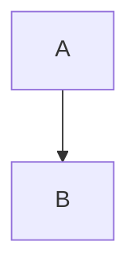

---
Etat:
  - Fait
Source: Recherche autonome (Claude)
Date de génération: 2026-06-30
aliases:
  - Stoa
---
> [!ai] Note générée par recherche autonome.

# Stoïcisme

Le **stoïcisme** est lié à [[Marc Aurèle|l'empereur]] et à [[epictète]] (casse différente).
Voir [[Livre#Première partie]] et [[Note absente]].

| A | B |
|---|---|
| [[Livre\|le livre]] | x |

%% commentaire caché [[Caché]] %%

==surligné== et une formule $E=mc^2$ et une note[^1].

[^1]: Détail de la note.

> [!warning]- Repliable
> Contenu replié.



```
[[Dans du code]]
```

![[image.png]]
